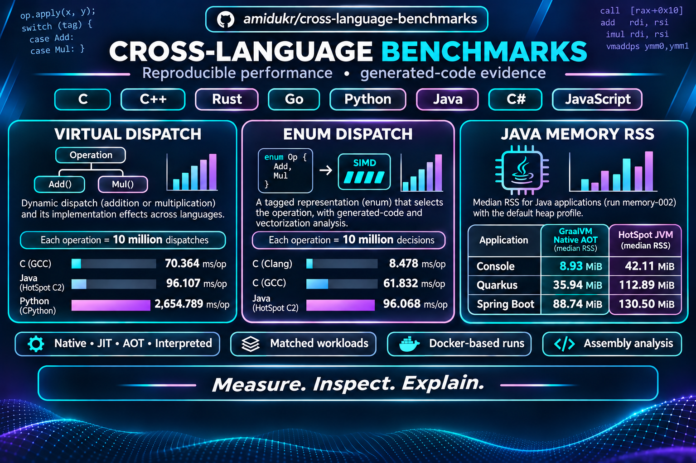

# Cross-language benchmarks

This repository compares equivalent workloads across programming languages, compilers, and runtimes. Its objective is to measure complete programs under documented, reproducible conditions and explain observed results with benchmark and generated-code evidence. These measurements describe the tested workloads and configurations; they do not establish universal language rankings or isolate one instruction's cost.

## Virtual dispatch (Tasks 1.1–1.3)

Prepared operations perform addition or multiplication through dynamic dispatch. Timing results below are medians from one process trial per target. Each complete benchmark operation contains 10 million dispatches; values are milliseconds per operation (`ms/op`). They are provisional observations from the recorded configuration.

| Target                             | Median (ms/op) |
| ---------------------------------- | -------------: |
| C (GCC)                            |         70.364 |
| C (Clang)                          |         81.541 |
| C# (.NET Native AOT)               |         84.224 |
| Rust (rustc)                       |         90.460 |
| C++ (GCC)                          |         92.844 |
| Java (Eclipse Temurin, HotSpot C2) |         96.107 |
| C++ (Clang)                        |         96.108 |
| Go                                 |        100.623 |
| Java (GraalVM JIT)                 |        104.341 |
| JavaScript (Node.js/V8)            |        111.522 |
| C# (.NET CoreCLR)                  |        114.917 |
| Java (GraalVM Native Image)        |        176.672 |
| Python (CPython)                   |       2654.789 |

The generated-code analysis highlights these code shapes:

| Target                                                    | Observed hot-path code shape                                                           |
| --------------------------------------------------------- | -------------------------------------------------------------------------------------- |
| Java (Eclipse Temurin, HotSpot C2) and Java (GraalVM JIT) | Guarded polymorphic paths are inlined to direct arithmetic in captured optimized code. |
| Java (GraalVM Native Image)                               | An indirect interface call remains in the captured diagnostic build.                   |

**References:** [Timing analysis](reports/virtual-dispatch-test.md); [generated-code analysis](reports/virtual-dispatch-test-assembly.md).

## Enum dispatch (Tasks 2.1–2.4)

Prepared records store an operation tag that selects addition or multiplication. Timing results are medians from one process trial per target. Each complete benchmark operation contains 10 million tag decisions; values are milliseconds per operation (`ms/op`). They are provisional observations from the recorded configuration.

| Target                             | Median (ms/op) |
| ---------------------------------- | -------------: |
| Rust (rustc)                       |          6.782 |
| C (Clang)                          |          8.478 |
| C++ (GCC)                          |         60.735 |
| C (GCC)                            |         61.832 |
| C# (.NET Native AOT)               |         70.527 |
| C++ (Clang)                        |         71.809 |
| C# (.NET CoreCLR)                  |         77.896 |
| Go                                 |         78.013 |
| Java (Eclipse Temurin, HotSpot C2) |         96.068 |
| Java (GraalVM JIT)                 |        106.103 |
| JavaScript (Node.js/V8)            |        118.879 |
| Java (GraalVM Native Image)        |        167.491 |
| Python (CPython)                   |       2275.403 |

The generated-code and vectorization review found:

| Target or compiler finding      | Observed hot-path code shape                                                                                                               |
| ------------------------------- | ------------------------------------------------------------------------------------------------------------------------------------------ |
| Rust and C (Clang)              | Branchless SIMD in the captured enum loop.                                                                                                 |
| C++ (Clang)                     | Scalar loop; Clang reports vectorization is not beneficial. The reason for its different profitability decision from C remains unresolved. |
| Other inspected implementations | Scalar code in the analyzed loop.                                                                                                          |

**References:** [Timing analysis](reports/enum-dispatch-test.md); [generated-code and vectorization analysis](reports/enum-dispatch-test-assembly.md).

## Matched virtual-versus-enum comparison (Task 3.1)

Five paired fresh-process trials compare both complete workloads for C, C++, and Java with matched inputs and settings. Their absolute columns show the target-level median of the five trial medians in milliseconds per operation. Their ratio is the median of the five paired enum/virtual ratios; values below 1 favor the enum workload. Rust was not included in Task 3.1; its row shows separate single-trial results from Tasks 1.2 and 2.2 and is not directly comparable or eligible for a matched ratio. Java JIT results are close because captured virtual hot paths are devirtualized and inlined. C++ favors enum dispatch in these trials, while C (Clang)'s large split coincides with SIMD in the enum workload and an indirect function-pointer call in the virtual workload. The comparison still includes other workload and representation differences.

| Target                             | Virtual median (ms/op) | Enum median (ms/op) | Median paired enum/virtual ratio |
| ---------------------------------- | ---------------------: | ------------------: | -------------------------------: |
| C (Clang)                          |                 78.807 |               7.932 |                            0.102 |
| Rust (rustc)\*                     |                 90.460 |               6.782 |                                — |
| C++ (Clang)                        |                 92.754 |              72.095 |                            0.777 |
| C (GCC)                            |                 71.051 |              61.741 |                            0.868 |
| C++ (GCC)                          |                 93.632 |              61.098 |                            0.653 |
| Java (Eclipse Temurin, HotSpot C2) |                 94.723 |              95.015 |                            1.003 |
| Java (GraalVM JIT)                 |                106.243 |             104.785 |                            0.991 |
| Java (GraalVM Native Image)        |                173.384 |             166.726 |                            0.962 |

\* Rust values come from separate single-trial reports with different workload settings; no matched ratio is available.

**References:** [Matched comparison analysis](reports/dispatch-differences-analysis.md); [virtual timing analysis](reports/virtual-dispatch-test.md); [enum timing analysis](reports/enum-dispatch-test.md); [virtual generated-code analysis](reports/virtual-dispatch-test-assembly.md); [enum generated-code and vectorization analysis](reports/enum-dispatch-test-assembly.md).

## Java application RSS (Task 4.1)

The memory benchmark covers console, Swing, Spring Boot, and Quarkus applications. The table shows median RSS over 100 samples for one trial with the default heap profile in run `memory-002`. Values are MiB. The default collector resolved to Serial for HotSpot and the Native Image default artifact. Swing Native Image AOT failed AWT initialization; the remaining failed and unavailable configurations are documented in the analysis.

| Application | Java (GraalVM Native Image AOT), median RSS (MiB) | Java (Eclipse Temurin HotSpot JVM), median RSS (MiB) |
| ----------- | -------------------------------------------------: | --------------------------------------------------: |
| Console     | 8.93 | 42.11 |
| Swing       | Failed: AWT initialization | 72.09 |
| Spring Boot | 88.74 | 130.50 |
| Quarkus     | 35.94 | 112.89 |

**References:** [Task 4.2 analysis](reports/java-memory-test.md); [Task specification](agent-tasks/4.1-java-minimum-rss.md); [memory-002 summary data](reports/java-memory-test/memory-002/summary.csv); [memory-002 matrix manifest](reports/java-memory-test/memory-002/matrix-manifest.txt).
